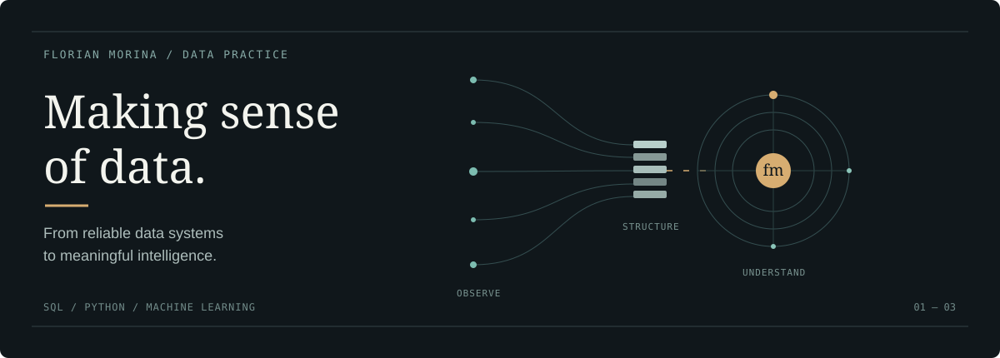

**Data engineering** &nbsp; / &nbsp; **Data science** &nbsp; / &nbsp; **Machine learning**

[Selected work](#selected-work) &nbsp; · &nbsp; [Toolkit](#toolkit) &nbsp; · &nbsp; [Contact](mailto:techflori.contact@gmail.com)

---

## Data, with purpose

I’m Florian, a Data Science student at FAU Erlangen–Nürnberg with hands-on experience in SQL, data integration and business logic. I’m interested in the full journey from **raw data to useful insights and intelligent applications**.

I enjoy understanding how systems work, making data more trustworthy and translating technical work into outcomes people can use. I’m exploring the intersection of data engineering, machine learning and AI.

## Focus areas

| 01 · Data systems | 02 · Analytics | 03 · Machine learning |
| :--- | :--- | :--- |
| SQL, data transformation, integration and quality checks. | Exploring data, asking business questions and communicating insights. | Experiments in clustering, PyTorch and model evaluation. |

## Selected work

### [K-Means Clustering ↗](https://github.com/techflori/simple-kmeans-clustering)
**Python · scikit-learn · Jupyter**  
An introductory unsupervised learning experiment using synthetic data, visualizations and cluster centroids.

### Professional experience
**SQL Server · data integration**  
Experience translating data workflows and business rules from Access into SQL Server. My public portfolio uses independent examples rather than company data.

## Toolkit

**Data & development** &nbsp; SQL · SQL Server · Python · pandas  
**Analysis & visualization** &nbsp; Power BI · Matplotlib · Jupyter  
**Machine learning** &nbsp; scikit-learn · PyTorch

## On my roadmap

- Build a reproducible data pipeline with validation and quality checks.
- Investigate a revenue change with SQL and a clear business recommendation.
- Develop and evaluate a PyTorch image classification project.

---

**Curious about data. Committed to building things that work.**  
[Email](mailto:techflori.contact@gmail.com) &nbsp; · &nbsp; [Explore repositories](https://github.com/techflori?tab=repositories)

